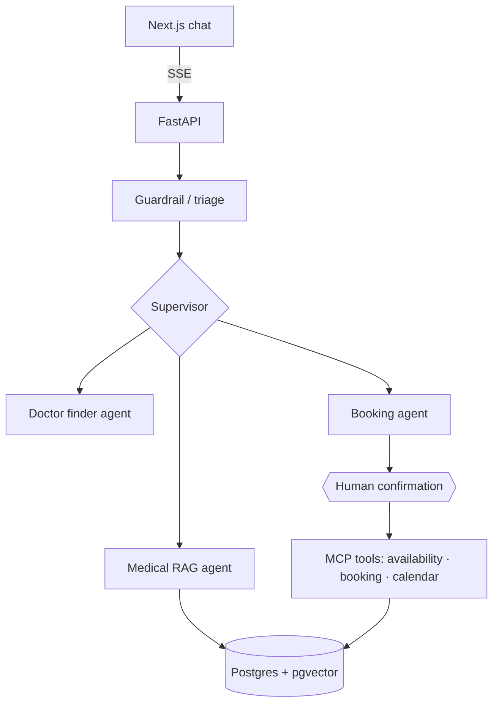

# MedAgent: Agentic AI Healthcare Assistant

**Multi-agent LangGraph system for medical Q&A, symptom-to-specialist triage and appointment
booking, with RAG, MCP tools, human-in-the-loop confirmation, evaluations and a CI/CD pipeline
that deploys to AWS.**


> 🚧 In active development. See [docs/PLAN.md](docs/PLAN.md) for the roadmap and progress.
> **Live demo:** _coming in Phase 8_

> ⚠️ MedAgent is a portfolio project. It gives general health information only and is not a
> substitute for professional medical advice. All patient data is synthetic.

## What it does

- **Answers medical questions** from a curated knowledge base, with source citations (hybrid RAG + reranking)
- **Routes symptoms to the right specialist** using structured LLM output
- **Books, reschedules and cancels appointments** through tool-calling agents, **pausing for your confirmation** before anything is booked
- **Detects emergencies** and redirects to emergency services instead of chatting
- **Remembers the conversation** across sessions (durable LangGraph checkpoints)

## Architecture



More diagrams (agent graph, booking sequence, RAG pipeline, CI/CD): [docs/ARCHITECTURE.md](docs/ARCHITECTURE.md)

## Tech stack

| Area | Technologies |
|---|---|
| Agents | LangGraph (supervisor, sub-agents, `interrupt()` HITL, Postgres checkpointer), structured outputs |
| LLM / RAG | OpenAI / Anthropic, pgvector, hybrid search, reranking, citations |
| Tools | Model Context Protocol (MCP) server, Google Calendar API |
| Backend | FastAPI (async, SSE), Pydantic v2, SQLAlchemy 2, Alembic, PostgreSQL 16 |
| Frontend | Next.js, TypeScript, Tailwind, shadcn/ui, Vercel AI SDK |
| Quality | pytest, RAGAS, DeepEval, Langfuse tracing, ruff, mypy, pre-commit, gitleaks |
| Delivery | Docker, GitHub Actions (CI + OIDC CD), Terraform, AWS ECR + ECS Fargate |

## Quick start

```powershell
copy .env.example .env          # add your keys (ANTHROPIC_API_KEY, a JWT_SECRET)
uv sync
docker compose up -d            # Postgres + pgvector
uv run alembic upgrade head
uv run python scripts/seed.py
uv run python scripts/serve.py  # API; on Windows this starts uvicorn on the right event loop
```

Open http://localhost:8000/docs (try it: register, **Authorize**, `POST /v1/chat`) or
http://localhost:8000/demo (a minimal page that shows the live stream). Full setup, including how
to generate `JWT_SECRET`: [docs/SETUP.md](docs/SETUP.md)

## API

| Endpoint | Purpose |
|---|---|
| `POST /v1/auth/register`, `POST /v1/auth/login`, `GET /v1/auth/me` | demo accounts (username + password only), JWT |
| `POST /v1/chat` | send a message; streams `step`, `token`, `confirmation`, `message`, `done` over SSE (`?stream=false` for JSON) |
| `POST /v1/chat/{id}/resume` | answer a pending booking/cancellation confirmation |
| `GET /v1/chat/{id}`, `GET /v1/limits` | history + pending confirmation; your daily allowance |
| `GET /v1/appointments`, `DELETE /v1/appointments/{id}` | your own appointments |
| `GET /health`, `GET /ready` | liveness, readiness |

The patient being booked always comes from your login token, never from the chat. The demo is
protected against cost abuse (rate limits, 50 messages per user per day, and a global daily budget).
Details: [ADR 0008](docs/adr/0008-api-auth-streaming-and-demo-protection.md).

## Development

```powershell
uv run ruff check . ; uv run ruff format .
uv run mypy src
uv run pytest
```

Contributing workflow: [CONTRIBUTING.md](CONTRIBUTING.md) · Decisions: [docs/adr](docs/adr)

## Evaluation results

_Filled in during Phase 7 (RAGAS faithfulness, answer relevancy, routing accuracy, booking task success)._

## Data sources and attribution

- **Knowledge base (public demo):** health topic summaries from
  [MedlinePlus](https://medlineplus.gov/), a service of the U.S. National Library of Medicine. NLM
  content is a U.S. federal work and not copyrighted; MedlinePlus is acknowledged as the source in
  every citation. MedlinePlus is not affiliated with this project and does not endorse it.
- **Not used in the public demo:** NHS Health A-Z (licence requires 7-day refresh and does not
  address AI use, see [ADR 0005](docs/adr/0005-rag-retrieval-and-corpus-licensing.md)) and any book
  or PDF we do not hold a licence to republish. Such files may be ingested locally for development
  and are flagged non-public, so `KB_PUBLIC_ONLY=true` keeps them out of retrieval.
- **Nearby clinics:** real places from [OpenStreetMap](https://www.openstreetmap.org/copyright),
  © OpenStreetMap contributors, available under the ODbL. Shown with attribution, cached for 24 h
  in line with the Nominatim/Overpass usage policies, and never bookable.
- **Public holidays:** from the open-source [`holidays`](https://github.com/vacanza/holidays)
  library (MIT), per doctor's city. Community data, not an official calendar.
- **People and appointments:** all doctors and patients are synthetic (Faker), not real people.

> Informational only. MedAgent does not give medical advice or diagnoses. In an emergency, call
> your local emergency number (112 in the EU, 911 in the US).

## License

MIT, see [LICENSE](LICENSE).
