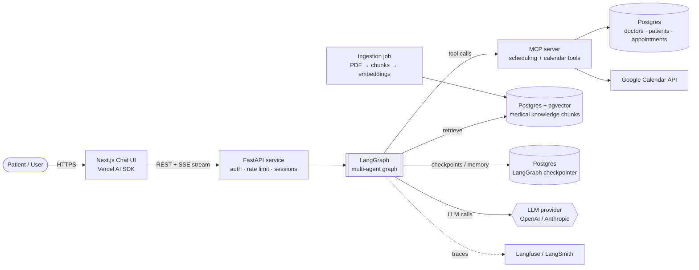
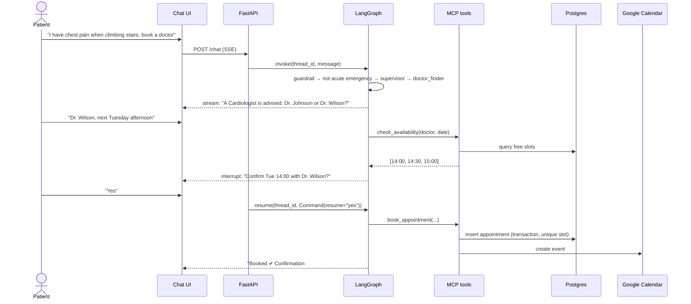
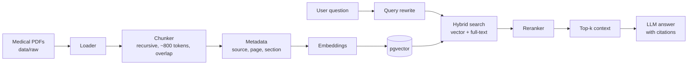
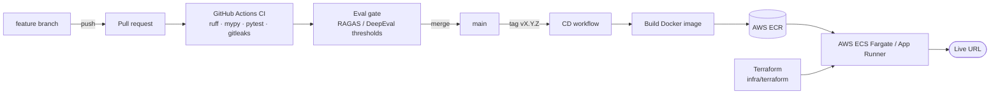

# MedAgent – Architecture & Flows

All diagrams are Mermaid. They render on GitHub and in VS Code (Markdown Preview, or the
"Markdown Preview Mermaid Support" extension).

---

## 1. System context



## 2. Agent graph (LangGraph)

```mermaid
flowchart TD
    START((START)) --> GR[guardrail<br/>deterministic red-flag rules EN/DE<br/>no LLM call]
    GR -->|acute red flag| OUT
    GR -->|ok, or general question<br/>+ safety notice| SUP{supervisor<br/>structured-output router<br/>+ is_emergency flag}
    SUP -->|is_emergency| OUT
    SUP -->|medical_question| RAG[medical_rag<br/>Phase 2 hybrid RAG · citations]
    SUP -->|find_doctor| DF[doctor_finder<br/>Specialty enum · DB lookup]
    SUP -->|book| BK[booking<br/>extract doctor/day/time · find a valid free slot]
    SUP -->|smalltalk / out_of_scope| RS[respond<br/>fixed replies]
    BK -->|proposal| HITL{{confirm<br/>interrupt&#40;&#41;: Book this slot?}}
    BK -->|question / refusal| OUT
    HITL -->|yes| BOOK[book_appointment<br/>re-validate · insert · unique index]
    HITL -->|no| OUT
    BOOK -->|slot lost| HITL
    BOOK -->|booked| OUT
    RAG --> OUT[output_guard<br/>disclaimer · citation check · safety notice]
    DF --> OUT
    RS --> OUT
    OUT --> END((END))
```



The exact compiled graph is generated into [docs/diagrams/agent_graph.md](diagrams/agent_graph.md)
by `scripts/export_graph.py`. State (`AgentState`) is persisted by the Postgres checkpointer per
`thread_id`, so each conversation keeps its memory and a paused confirmation can be answered after a
restart. The patient being booked comes from the run config (login), never from the conversation.

## 3. Booking flow (sequence)



## 4. RAG pipeline



## 5. Delivery pipeline (CI/CD)



## 6. Repository layout

```
agentic-healthcare-assistant/
├── src/medagent/
│   ├── main.py              FastAPI app factory
│   ├── core/                settings, logging, security
│   ├── api/routes/          health, chat (SSE), auth, appointments
│   ├── agents/              state.py, graph.py, nodes/, prompts/
│   ├── tools/               typed LangChain tools
│   ├── rag/                 ingestion, retrieval, reranking
│   ├── db/                  engine, session, models/
│   ├── services/            pure domain logic (availability, validation)
│   ├── schemas/             shared Pydantic models
│   ├── guardrails/          emergency, PII, disclaimer
│   ├── mcp_server/          MCP tool server
│   └── observability/       tracing
├── tests/unit · tests/integration
├── evals/                   datasets + eval scripts + results
├── migrations/              Alembic
├── frontend/                Next.js app (Phase 6)
├── infra/docker · infra/terraform
├── data/raw · data/processed  (git-ignored)
├── docs/                    PLAN, ARCHITECTURE, SETUP, adr/
└── .github/                 workflows, templates, dependabot
```
